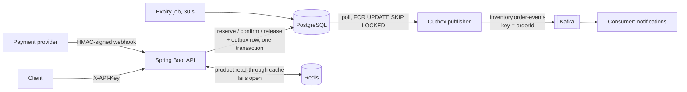

# Inventory & Order Reservation Service

Spring Boot 4 · Java 21 · PostgreSQL 17 · Redis 7 · Kafka · Flyway · Testcontainers

Reserves stock for orders with a 15-minute hold, confirms or releases it when
payment resolves, and publishes order events through a transactional outbox.
Designed around three guarantees, each covered by an integration test
(`OrderFlowIT`, runs against real PostgreSQL):

| Guarantee | How | Test |
|---|---|---|
| Never oversell | One atomic `UPDATE ... WHERE on_hand - reserved >= :qty`, plus DB `CHECK (reserved <= on_hand)` | 500 concurrent orders on 100 units → exactly 100 accepted |
| Safe client retries | Mandatory `Idempotency-Key` + SHA-256 request fingerprint; unique-index race handled outside the transaction | 50 parallel same-key requests → 1 order, 1 reservation |
| Stock deducted once | Order row locked `FOR UPDATE`, explicit state machine, idempotent callbacks | 20 parallel payment callbacks → 1 `SALE` movement |

## Architecture



It is a single deployable service (a modular monolith), not microservices.

## Run

```bash
# Infrastructure only, app on the host:
docker compose up -d
./mvnw spring-boot:run                       # http://localhost:8081

# Everything in containers:
docker compose --profile app up -d --build
```

Defaults for local development: API key `dev-api-key-change-me`, webhook secret
`dev-webhook-secret-change-me`. Override with `INVENTORY_API_KEY` /
`PAYMENT_WEBHOOK_SECRET` (and `DB_PASSWORD`) in any real environment.

## Test

```bash
./mvnw test       # fast unit tests, no Docker
./mvnw verify     # + Testcontainers integration tests (needs Docker) + JaCoCo report
                  #   coverage: target/site/jacoco/index.html
```

CI (`.github/workflows/ci.yml`) runs `./mvnw verify` on every push and PR.

## API

All `/api/**` routes need `X-API-Key`, except the two payment webhooks, which
need an HMAC signature instead.

| Method | Path | Purpose |
|---|---|---|
| POST | `/api/products` | Create product + initial stock |
| GET | `/api/products/{id}` | Product with live stock |
| GET | `/api/products?page=0&size=20` | List products (max size 100) |
| PATCH | `/api/products/{id}` | Update name / price / active |
| GET | `/api/inventory/{productId}` | on-hand / reserved / available |
| POST | `/api/inventory/adjustments` | Add or remove stock (`delta`), never below reserved |
| GET | `/api/inventory/{productId}/movements?page=0&size=50` | Movement ledger, newest first (max size 200) |
| POST | `/api/orders` | Create order + reserve stock (**`Idempotency-Key` required**) |
| GET | `/api/orders/{id}` | Order status |
| POST | `/api/orders/{id}/cancel` | Cancel unpaid order, release stock |
| POST | `/api/orders/{id}/payment/success` | Provider callback: confirm, deduct stock (HMAC) |
| POST | `/api/orders/{id}/payment/failure` | Provider callback: fail, release stock (HMAC) |

Webhook signature: `HMAC_SHA256(secret, "<epochSeconds>.<METHOD>.<path>")` as
hex, sent in `X-Webhook-Timestamp` and `X-Webhook-Signature`; requests more
than 300 s old are rejected.

Operational endpoints: `/actuator/health/readiness` (includes DB),
`/actuator/health/liveness`, `/actuator/prometheus`. Custom metrics:
`inventory.orders{outcome}`, `inventory.outbox.published|failed|pending`.

## Manual walkthrough

```bash
B=http://localhost:8081/api; K='X-API-Key: dev-api-key-change-me'; J='Content-Type: application/json'
SECRET=dev-webhook-secret-change-me
pay() {   # pay <orderId> success|failure
  P=/api/orders/$1/payment/$2; TS=$(date +%s)
  SIG=$(printf '%s' "$TS.POST.$P" | openssl dgst -sha256 -hmac "$SECRET" -hex | sed 's/^.* //')
  curl -s -X POST "http://localhost:8081$P" -H "X-Webhook-Timestamp: $TS" -H "X-Webhook-Signature: $SIG"; echo
}

# 1. product with 10 units
curl -s -X POST $B/products -H "$K" -H "$J" \
  -d '{"sku":"SKU-1","name":"Widget","price":100.00,"initialStock":10}'

# 2. order 3 units -> RESERVED / PENDING, available 7
curl -s -X POST $B/orders -H "$K" -H "$J" -H 'Idempotency-Key: order-1' \
  -d '{"items":[{"productId":1,"quantity":3}]}'

# 3. same key + same body -> same order replayed, stock NOT reserved twice
curl -s -X POST $B/orders -H "$K" -H "$J" -H 'Idempotency-Key: order-1' \
  -d '{"items":[{"productId":1,"quantity":3}]}'

# 4. same key + different body -> 409
curl -s -X POST $B/orders -H "$K" -H "$J" -H 'Idempotency-Key: order-1' \
  -d '{"items":[{"productId":1,"quantity":4}]}'

# 5. pay twice -> CONFIRMED; on-hand 7, reserved 0; second call changes nothing
pay 1 success; pay 1 success; curl -s -H "$K" $B/inventory/1

# 6. unsigned callback -> 401
curl -s -o /dev/null -w '%{http_code}\n' -X POST $B/orders/1/payment/success

# 7. over-order -> 409 "Insufficient stock"
curl -s -X POST $B/orders -H "$K" -H "$J" -H 'Idempotency-Key: order-2' \
  -d '{"items":[{"productId":1,"quantity":99}]}'
```

## Load test

```bash
brew install k6      # or: https://grafana.com/docs/k6/latest/set-up/install-k6/
docker compose --profile app up -d --build
k6 run loadtest/k6-order-flow.js
```

Record your own results here (run on a stated machine; the numbers below are
placeholders until you measure):

| Scenario | Rate | p50 | p95 | p99 | Errors | Notes |
|---|---|---|---|---|---|---|
| many SKUs (200) | _ req/s | _ ms | _ ms | _ ms | _ % | |
| hot SKU (1 product) | _ req/s | _ ms | _ ms | _ ms | _ % | reserved == accepted, 0 oversold |

## Design notes and known limitations

- **Late payments.** If the provider calls back after the 15-minute hold has
  expired, nothing is deducted, the endpoint answers 409, and a
  `PAYMENT_RECONCILIATION_REQUIRED` event is written to the outbox. No
  consumer issues the refund yet; that is the next step.
- **Outbox delivery is at-least-once.** A batch is sent asynchronously and
  stops at the first failure, so a consumer can see a duplicate and should
  dedupe on the `event-id` header. The bundled consumer only logs.
- **Ordering with several app instances.** `SKIP LOCKED` lets instances take
  different batches; events of one order stay ordered per Kafka partition, but
  a strict cross-instance guarantee would need per-aggregate claiming.
- **Auth is deliberately small** (static API key + HMAC webhook). Replace with
  OAuth2/JWT and per-client keys before real use; keep `/actuator` private.
- Redis and Kafka outages degrade gracefully (cache fails open; outbox rows
  wait) and do not fail the readiness probe; PostgreSQL does.
